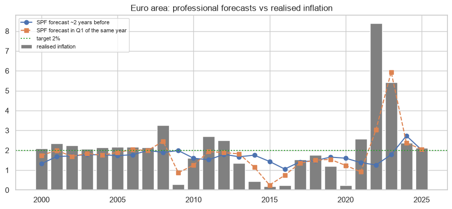
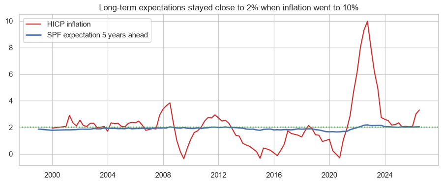

# How good are the ECB professional inflation forecasts?

I evaluate the ECB Survey of Professional Forecasters, check if long-term expectations stayed anchored during the 2022 inflation, and compare France with the euro area.

## Data
ECB Data Portal (SPF, HICP, deposit facility rate) and Eurostat HICP (ECOICOP v2) for 2026.

## Main results
- The error grows with the horizon: RMSE 0.11 points in the last quarter of the year, 1.17 one year before and 1.76 two years before. On average the forecasters underestimate inflation.
- Biggest miss: in 2021 they expected 1.26% for 2022, and it was 8.38%.
- Long-term expectations stayed between 1.97% and 2.18% in 2022-2023, but since 2020 they react a little more to current inflation.
- September 2026: inflation 3.8% in the euro area and 3.4% in France, deposit rate 2.5%, so the real rate in France is -0.9%.




## How to run

```
pip install -r requirements.txt
jupyter notebook ecb_inflation_expectations.ipynb
```

---
Alejandro Lezcano Osorio | Universidad EIA (Colombia) and Rennes School of Business (France)
